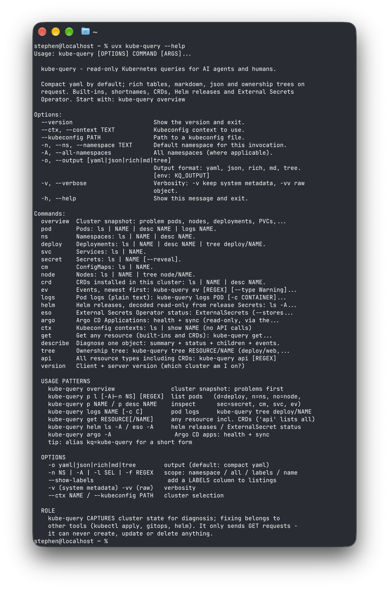
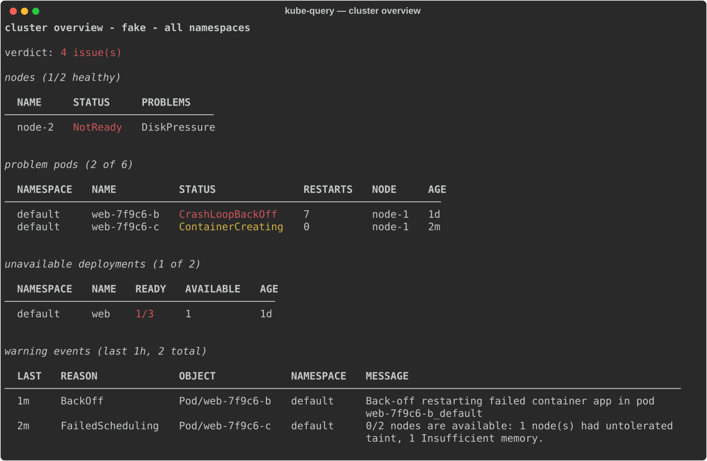
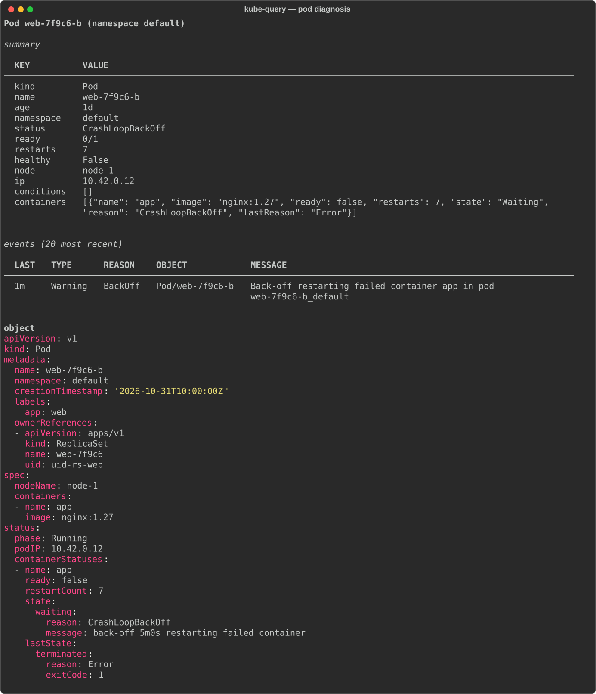
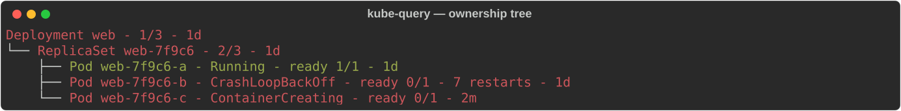
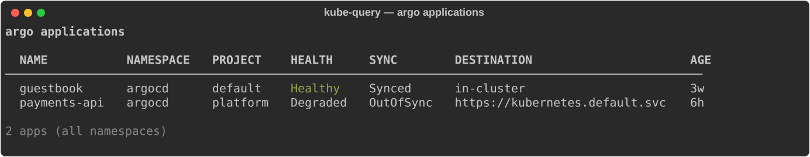
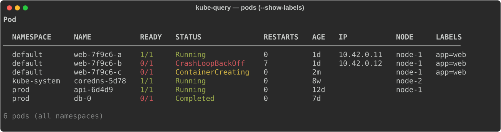

# kube-query

**Read-only Kubernetes queries for humans and AI agents.**
kubectl for diagnosis — without the ability to break anything.

---

kubectl is a loaded gun in an agent's hands. kube-query is the safe scope:
it **captures cluster state and diagnoses problems**, and *cannot* create,
update or delete anything — the HTTP layer implements `GET` and nothing else.
Compact YAML by default, with rich tables, markdown, JSON and ownership
trees on request. Built-ins, shortnames, CRDs, Argo CD, Helm releases and
External Secrets Operator — one small, fast CLI.

```
kube-query p l -A                    # all pods, all namespaces
kube-query p desc web-5d9c6 -n prod  # status + reasons + restarts + events, one doc
kube-query logs web-5d9c6 -n prod -c app --previous
kube-query tree deploy/web -n prod   # Deployment -> ReplicaSet -> Pods, health per node
kube-query overview                  # whole-cluster snapshot, problems first
```

> kube-query is the **diagnosis** half of the loop. The **fix** half belongs to other
> tools (kubectl apply, gitops, helm) — by design.

## Screenshots

<p align="center">
  
</p>
<sub>Everything an agent needs to discover in one screen: usage patterns, options, the read-only contract.</sub>

**`kube-query overview -o rich`** — cluster snapshot, problems first:


**`kube-query p desc web-7f9c6-b`** — one pod: summary, restarts, reasons, related events:


**`kube-query tree deploy/web`** — ownership chain with health per node:


**`kube-query argo -A`** — Argo CD applications, health + sync:


**`kube-query p l -A --show-labels`** — labels as a column:


<sub>Screenshots are generated from the fake demo cluster (`make screenshots`) — no real cluster data.</sub>

## Why

| Problem with `kubectl` for agents | kube-query |
|---|---|
| can `delete`/`scale`/`apply` — one hallucinated flag away from an incident | GET-only; no mutating code path exists |
| `-o yaml` dumps managedFields/uid/annotations noise into context | compact by default, `-v`/`-vv` for more |
| output shaped for terminals, not reasoning | yaml/json data, md reports, tree views |
| 100+ verbs to misuse | ~15 read verbs with short aliases (`p l`, `d l`, `c l`) |
| helm/ESO/CRD troubleshooting needs extra tools | helm releases, ESO status and CRDs built in |

## Install

Requires Python 3.13+. The PyPI package is **`kube-query`** and it installs a
single command: `kube-query`. (There is deliberately no short `kq` executable —
that name on PyPI belongs to an unrelated Kafka library, and PyPI's
similarity rules block close variants like `kubeq`. Alias it if you want it
short: `alias kq=kube-query`.)

```bash
uvx kube-query overview             # one-off, no install
uv tool install kube-query          # permanent
pipx install kube-query             # alternatives
pip install kube-query

kube-query ctx ls                   # verify — reads your existing kubeconfig
alias kq=kube-query                 # optional short form
```

From source:

```bash
git clone https://github.com/stivio00/kube-query && cd kube-query
make setup                          # .venv (py3.13) + dev deps
.venv/bin/kube-query overview
```

No cluster to try it on? `make demo` boots a fake API server with broken
pods, a stuck deployment, helm releases and ESO resources to poke at.

## Commands

| Command (aliases) | Purpose |
|---|---|
| `kube-query overview` (`ov`, `o`, `health`) | cluster snapshot: problem pods, nodes, deployments, PVCs, warnings |
| `kube-query pod` (`pods`, `p`, `po`) | `l [REGEX] [-A\|-n\|-l\|--field-selector]` · `NAME` · `desc NAME` · `logs NAME` |
| `kube-query deploy` (`deployments`, `dep`, `d`) | same shape for deployments |
| `kube-query ns` (`n`) · `kube-query node` (`no`) · `kube-query svc` · `kube-query cm` | namespaces, nodes, services, configmaps |
| `kube-query crd` (`crds`) | CRDs installed in the cluster (group, kind, Established) |
| `kube-query secret` (`sec`) | values hidden; `kube-query sec NAME --reveal` decodes (explicit opt-in) |
| `kube-query ev` (`events`, `e`) | events, newest first: `--type Warning --since 2h --for pod/NAME` |
| `kube-query get RESOURCE[/NAME]` (`g`) | any resource incl. CRDs; `kube-query api` lists all types |
| `kube-query describe` (`desc`) | diagnosis bundle: summary + object + children + events |
| `kube-query tree RESOURCE/NAME` (`t`) | ownership tree (`deploy/web`, `cronjob/x`, `node/y`) |
| `kube-query helm` (`h`) | releases read-only from Helm's release Secrets; `show NAME` adds values |
| `kube-query eso` | ExternalSecret sync status (`--stores` for SecretStores) |
| `kube-query argo` (`argocd`) | Argo CD Applications: health + sync |
| `kube-query ctx` (`c`) | kubeconfig contexts (`kube-query c l`), no API calls |
| `kube-query ver` | client + server version (which cluster am I on?) |

Shared flags: `-n NS` · `-A` · `-l SELECTOR` · `--field-selector` · `-f/--filter REGEX`
· `-o yaml|json|rich|md|tree` (default yaml, `KQ_OUTPUT` env) · `-v`/`-vv`.

## Output

```bash
kube-query overview -o rich      # aligned, colored tables (humans)
kube-query p l -A -o md          # markdown tables (tickets, chat, agent reports)
kube-query p web-5d9c6 -o json   # machine-readable
kube-query d l -o tree           # ownership view
```

Stdout is always the payload (parseable); commentary goes to stderr as
`#`-prefixed notes. Exit codes: `0` ok, `1` error (one actionable sentence),
`2` usage.

## For AI agents

Give your agent (Claude Code, opencode, codex, …) the one-file skill:
[`SKILL.md`](SKILL.md) — command map, the 5-move triage loop, output
contract, failure-signature table, and rules of engagement. Suggested
system-prompt line:

> Use `kube-query` (read-only) to inspect the Kubernetes cluster: start with
> `kube-query overview`, then `kube-query p desc <pod>`, `kube-query logs`, `kube-query tree`, `kube-query ev`.
> Never attempt cluster changes with kube-query; propose them for kubectl instead.

## Documentation

| Doc | Contents |
|---|---|
| [docs/usage.md](docs/usage.md) | full manual: every command, flag, format, exit code |
| [docs/tutorial.md](docs/tutorial.md) | hands-on: debugging a broken deployment end-to-end |
| [docs/architecture.md](docs/architecture.md) | module map + data flow diagrams |
| [docs/extending.md](docs/extending.md) | add commands, columns, formats (with examples) |
| [docs/roadmap.md](docs/roadmap.md) | what's next + explicit non-goals |
| [CHANGELOG.md](CHANGELOG.md) | releases |

## Development

```bash
make setup          # venv + deps
make check          # the full gate: ruff lint + format check + pytest + build
make demo           # fake-cluster playground
make screenshots    # regenerate docs/img/*.svg for the README
make tag            # run the gate, then create v<version> tag
git push origin vX.Y.Z   # CI publishes to PyPI (trusted publishing)
```

Pipeline: `make check` mirrors CI exactly; pushing a `v*` tag runs the same
gate, builds sdist+wheel, verifies tag/version match, and publishes via
GitHub Actions to PyPI — no stored secrets (OIDC trusted publishing).

Tests are network-free: unit suites plus smoke tests that drive the real CLI
against an in-process fake Kubernetes API server.

## Safety model

1. `kube_query/http.py` exposes `raw_get` only — there is no verb parameter anywhere.
2. `kube_query/access.py` builds list/get/log paths only.
3. Secret values are redacted unless `--reveal` is passed explicitly.
4. Your RBAC still applies — kube-query reads exactly what your credentials allow.

## License

MIT — see [LICENSE](LICENSE).
